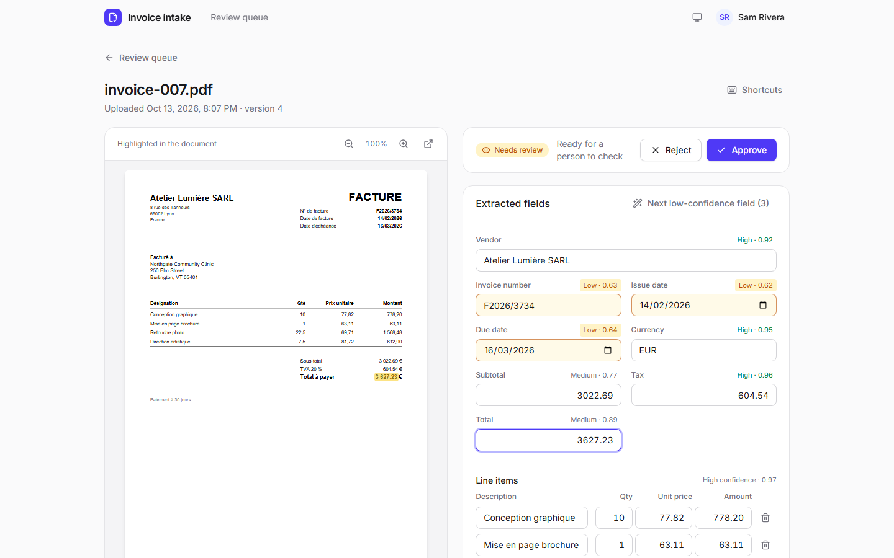
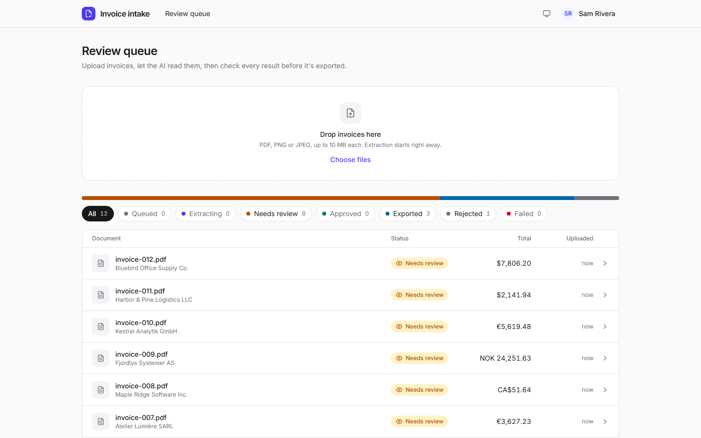
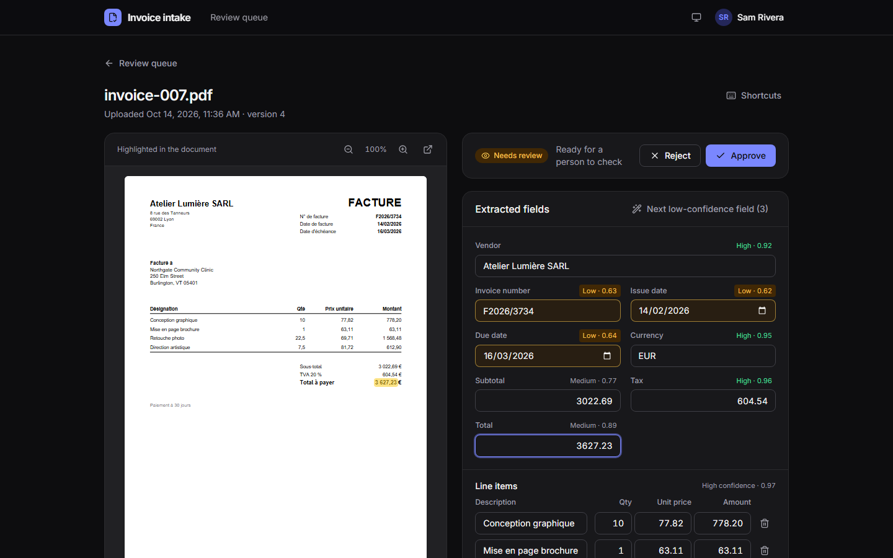
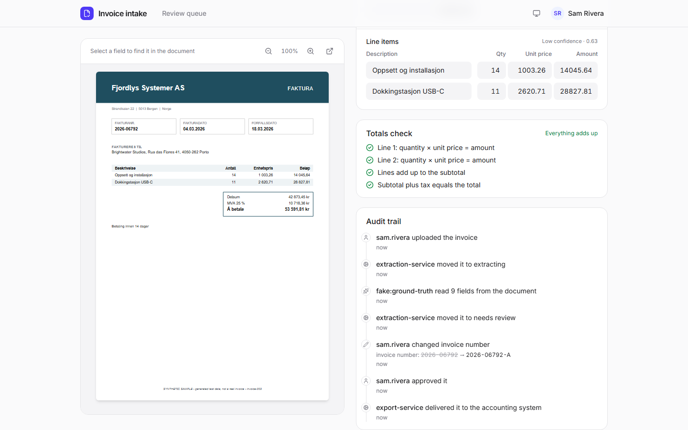
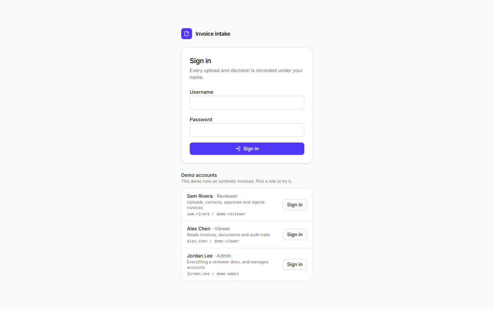
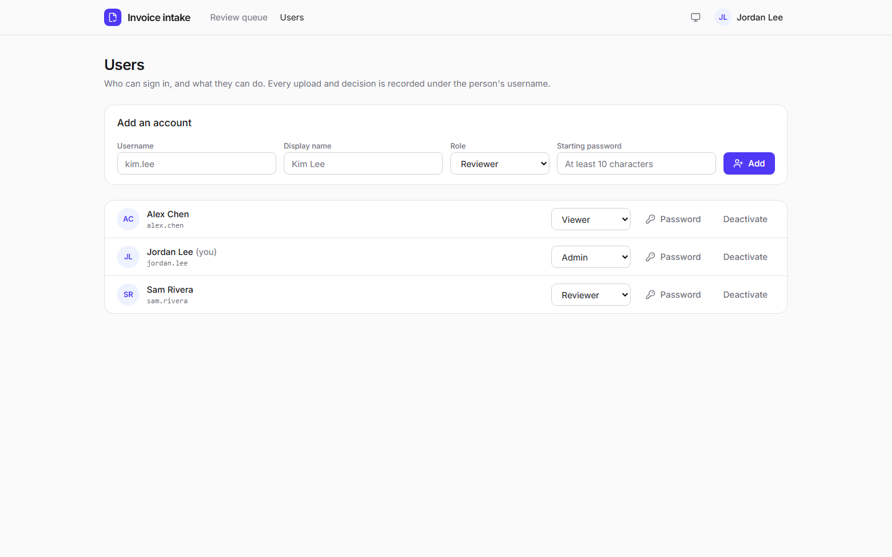
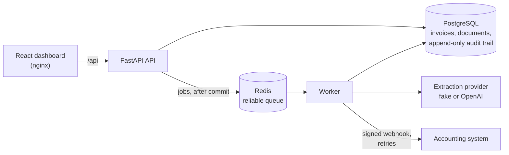
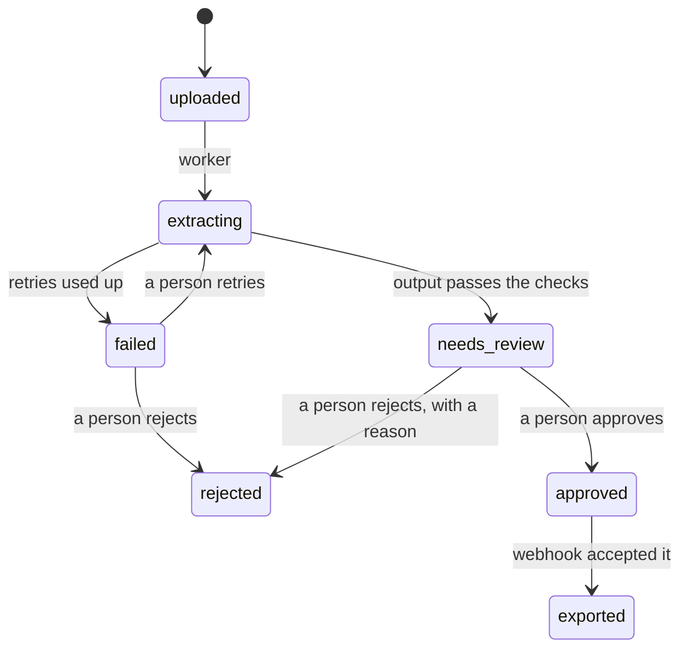

# AI Invoice Intake

[](https://github.com/maideps/ai-invoice-intake/actions/workflows/ci.yml)

**Upload an invoice, let an AI read it, check every field against the document, and only then send it to accounting.** A full-stack, human-in-the-loop invoice pipeline: FastAPI, PostgreSQL, a Redis-backed worker and a React + TypeScript review dashboard. People sign in with a role (viewer, reviewer, admin), and every AI output and every human decision is kept in an append-only audit trail under who made it.



> **Portfolio project.** All invoices are synthetic: generated, with invented vendors and amounts. The project was built one feature at a time with [ai-harness-framework](https://github.com/maideps/ai-harness-framework) (see [Built with ai-harness-framework](#built-with-ai-harness-framework)).

## Run it in five minutes

All you need is Git and Docker (Docker Desktop, or Docker Engine with Compose v2.17 or newer), with Docker running. New to these, or something not working? The [step-by-step install guide](docs/INSTALL.md) explains each step, everyday commands, settings and troubleshooting.

```bash
git clone https://github.com/maideps/ai-invoice-intake.git
cd ai-invoice-intake
docker compose up --build
```

Open **http://localhost:8080** once the log says the seed uploaded the samples, and sign in with one of the demo accounts listed there: **Sam Rivera** (reviewer) for the main flow, **Alex Chen** (viewer, read-only) or **Jordan Lee** (admin, also manages accounts). The first start downloads the base images and dependencies and builds two images: from an empty build cache it took between three and a half and five minutes here, clone included, depending on the network and what else the machine is doing. After that it starts in seconds.

Then try the main flow:

1. The queue already holds 12 synthetic invoices, read by the AI and waiting in **Needs review**.
2. Open one. Click a field, such as **Total**, and the value lights up where it is printed in the PDF. Amber fields are ones the model was unsure about.
3. Correct a field if you like, save, and press **Approve** (or the `A` key).
4. A few seconds later the invoice shows **Exported**. A demo accounting system received it as a signed webhook: `docker compose logs accounting` prints the delivery, and http://localhost:9000/deliveries lists them.
5. Sign out (menu at the top right) and sign in as Alex Chen: the same screens, read-only. As Jordan Lee, the **Users** screen manages accounts.

`Ctrl+C` stops it. `docker compose down` removes the containers and keeps the data; `docker compose down -v` deletes the data too. Extraction uses a deterministic `fake` provider, so no API key or network is needed. To use OpenAI instead, start it with `INVOICE_INTAKE_EXTRACTION_PROVIDER=openai INVOICE_INTAKE_OPENAI_API_KEY=...`. If ports 8080 or 9000 are taken, set `INVOICE_INTAKE_WEB_PORT` or `INVOICE_INTAKE_ACCOUNTING_PORT`. The database password, the webhook secret and the demo accounts' passwords are fixed demo values: this stack is meant for your machine, not a server ([D-015](DECISIONS.md#d-015-docker-compose-for-the-whole-product-and-the-projects-own-ci)).

## A walk through it

**The review queue.** Counts per status double as filters, uploads go into the drop zone, and the list refreshes on its own while the worker is busy, so invoices visibly move from queued to extracting to needs review.



**The review screen** (at the top of this page) puts the original document beside the extracted fields. Selecting a field finds its value in the PDF, including local formats such as `3 627,23` or `14/02/2026`. Fields are tinted by the model's confidence, a totals check confirms that the lines, subtotal, tax and total add up (in exact cents), and the keyboard works too (`J`/`K`, `E`, `S`, `A`, `R`, `?`). The theme follows the system:



**Approval and export.** Only a person can approve, and only an approved invoice is ever exported. The audit trail shows who did what: the upload, the AI's reading, a reviewer's correction (old and new value), the approval and the delivery to the accounting system. If the webhook fails, the worker retries with backoff; each failed attempt is recorded, and the screen offers **Retry export** when the attempts run out.



**Signing in and roles.** Every action is tied to a signed-in account, so the audit trail's "who approved it" can be trusted. A **viewer** reads everything; a **reviewer** also uploads and decides; an **admin** also manages accounts on the Users screen (add, change a role, deactivate, set a password). The API enforces each role on every route, not just the UI. In the Docker demo the sign-in page lists one demo account per role.

 

## How it works



Each invoice moves through an explicit state machine in the domain layer. Every move is recorded with its actor, and the domain checks that the actor is allowed to make it: only a person approves or rejects, and the platform makes every other move.



What holds it together:

- **AI output is a draft.** The model's answer is validated against one schema in one place and kept in the audit trail whether it is accepted or not. Nothing reaches `exported` without a person's approval.
- **The audit trail cannot be rewritten.** A database trigger refuses updates and deletes on audit events; an invoice is rebuilt by replaying its trail through the lifecycle rules.
- **Slow work happens in the background.** An upload answers in milliseconds. Jobs go to Redis only after the transaction commits. The queue never loses a job: a worker that crashes leaves it to be picked up again. The steps are idempotent, so running one twice is harmless.
- **Who did what can be trusted.** People sign in; the session is an HttpOnly, SameSite cookie whose token is stored only as a hash; passwords are scrypt hashes. Every route declares the role it needs, and a test walks all routes so a new one can't be left open.
- **Concurrent reviewers don't overwrite each other.** Every edit and decision carries the version the reviewer saw; a stale one is refused with 409 and the screen offers a reload.
- **The provider is configuration.** The extraction provider sits behind an interface owned by the domain; one factory reads the setting, and tests never call a real model.
- **Layering is enforced.** The domain imports only the standard library, and the API and services never import infrastructure. `npm run check-arch` fails if either rule is broken.

<details>
<summary>In more detail: extraction, review, export and the dashboard</summary>

**AI extraction.** `INVOICE_INTAKE_EXTRACTION_PROVIDER` picks the provider (D-005). The default, `fake`, needs no key or network: it recognises the synthetic samples and returns their ground truth (any other document comes back empty for a reviewer to fill in). For real extraction set it to `openai` together with `INVOICE_INTAKE_OPENAI_API_KEY` (and optionally `INVOICE_INTAKE_OPENAI_MODEL`, default `gpt-5.4-mini`); the app refuses to start if the key is missing. Every model output is validated against one schema and kept in the audit trail, accepted or not (D-008). Tests never call the real model.

**Background extraction.** An upload returns at once with status `uploaded`; the job goes to Redis after the upload is committed. The worker (`npm run dev:worker`) moves the invoice to `extracting` and then `needs_review`. Provider errors and rejected output are retried (`INVOICE_INTAKE_EXTRACTION_MAX_ATTEMPTS`, default 3, with doubling waits from `INVOICE_INTAKE_EXTRACTION_RETRY_BASE_SECONDS`, default 5); when the attempts run out the invoice is `failed` with the reason in its audit trail. `POST /invoices/{id}/extract` (202) asks for another try; on a `failed` invoice it records who asked. If Redis is down during an upload, the upload still succeeds and the worker's periodic sweep queues it later (D-010).

**Review.** `PATCH /invoices/{id}/fields`, `POST /invoices/{id}/approve` and `POST /invoices/{id}/reject` work only in `needs_review` and record the signed-in reviewer (D-019). Each request carries the invoice `version` the reviewer saw; if the invoice changed since, the answer is 409 and nothing changes. Approval needs vendor name, invoice number, issue date, currency and total; rejection needs a reason (D-009).

**Export.** Approving an invoice queues an export job. The worker posts the invoice as JSON to `INVOICE_INTAKE_EXPORT_WEBHOOK_URL` (the stand-in for an accounting system) and moves it to `exported` on any 2xx answer. Non-2xx answers, timeouts and connection errors are retried (`INVOICE_INTAKE_EXPORT_MAX_ATTEMPTS`, default 5, with doubling waits from `INVOICE_INTAKE_EXPORT_RETRY_BASE_SECONDS`, default 10), and each failed attempt is recorded in the audit trail. After the last attempt the review screen offers "Retry export" (`POST /invoices/{id}/export`, 202). Only approved invoices are ever sent. The body carries `payload_version`, the invoice id, file name, who approved it and when, the audit version and the fields in the API's format. Each request has an `Idempotency-Key` (the invoice id, the same on every attempt), a per-attempt `X-Invoice-Intake-Delivery` id, and, when `INVOICE_INTAKE_EXPORT_WEBHOOK_SECRET` is set, `X-Invoice-Intake-Signature: sha256=<HMAC-SHA256 of the body>`. Delivery is at least once, so receivers should drop duplicates by `Idempotency-Key`. Without a URL, export is off: approved invoices wait, the screen says so, and `GET /health` reports `export_configured: false` (D-014).

**Dashboard.** `repositories/frontend/` is React 19 + TypeScript (strict) on Vite 7, styled with Tailwind CSS v4 and small shadcn/ui-style components, with TanStack Query for server state (D-012). The review queue shows a count per status (doubling as filters, kept in the URL), a drop zone for uploads, and a list that refreshes every 2 seconds while the worker is busy (15 seconds otherwise), so invoices visibly move from queued to needs review. It has loading, empty and error states, light and dark themes (following the system by default), and a sign-in page with a user menu; viewers see the same screens read-only, and admins get a Users screen. API types are generated from FastAPI's OpenAPI document (`npm run api:types`); tests fail if they drift.

**Review screen.** Opening an invoice shows the original PDF (pdf.js, with its text layer) beside the extracted fields. Selecting a field finds its value in the document and highlights it, trying local formats such as `3 627,23` and `14/02/2026`. Low-confidence fields are tinted amber, with a "next low-confidence field" button. A totals check confirms the lines add up to the subtotal and the subtotal plus tax to the total, in exact cents. Edits, approval and rejection send the invoice `version`; a conflict shows a reload banner instead of an error. The audit trail reads as a timeline, and the keyboard works too (`J`/`K`, `E`, `S`, `A`, `R`, `?`).

More in [docs/ARCHITECTURE.md](docs/ARCHITECTURE.md) and [docs/PRODUCT.md](docs/PRODUCT.md).

</details>

## Design decisions

Each decision is recorded with its context, the alternatives and the consequences in [DECISIONS.md](DECISIONS.md).

| Decision | In short |
|---|---|
| [D-005](DECISIONS.md#d-005-the-ai-extraction-provider-is-chosen-by-configuration) | The extraction provider is chosen by configuration (`fake` by default, `openai`), behind an interface the domain owns. |
| [D-006](DECISIONS.md#d-006-synthetic-samples-are-generated-deterministically-and-committed) | Synthetic samples are generated deterministically and committed; a test fails if they drift. |
| [D-007](DECISIONS.md#d-007-persistence-on-postgresql-with-sqlalchemy-2-alembic-and-container-based-tests) | PostgreSQL with SQLAlchemy 2 and Alembic; an append-only trigger on the audit trail; tests against throwaway containers that fail, never skip, without Docker. |
| [D-008](DECISIONS.md#d-008-every-ai-output-is-validated-in-one-place-and-kept-in-the-audit-trail) | Every model output is validated in one place and kept, accepted or rejected, in the audit trail. |
| [D-009](DECISIONS.md#d-009-review-uses-optimistic-versions-audited-edits-and-a-minimum-for-approval) | Optimistic versions on every review request, audited edits with old and new values, and a minimum set of fields before approval. |
| [D-010](DECISIONS.md#d-010-extraction-runs-in-a-worker-fed-by-a-small-reliable-queue-on-redis) | A small reliable queue on Redis (ready list, delayed set, per-worker processing list) instead of a task framework that does not run on Windows. |
| [D-012](DECISIONS.md#d-012-frontend-stack-and-how-it-joins-the-harness-gates) | React 19, strict TypeScript, Vite, Tailwind and TanStack Query, with an API client generated from OpenAPI and checked for drift. |
| [D-013](DECISIONS.md#d-013-end-to-end-tests-run-the-real-stack-with-playwright) | End-to-end tests run the real stack (containers, API, worker, web app) with Playwright. |
| [D-014](DECISIONS.md#d-014-export-to-a-signed-webhook-from-the-same-worker) | Export to an HMAC-signed webhook from the same worker, with an idempotency key, retries, and a state derived from the trail. |
| [D-015](DECISIONS.md#d-015-docker-compose-for-the-whole-product-and-the-projects-own-ci) | One-command Docker Compose stack with seeded samples and a demo receiver; CI checks the source and the packaged stack. |
| [D-016](DECISIONS.md#d-016-a-product-first-readme-checked-and-reproducible) | This README: product first, screenshots regenerated from the real stack, links and scripts checked in lint, the five-minute start measured from a clean clone. |
| [D-017](DECISIONS.md#d-017-backend-and-frontend-as-repositories-of-the-multi-repo-component-in-one-git-repository) | The backend and the frontend live in `repositories/`, each with its own `scripts/verify`; the OpenAPI document is the contract between them, in `contracts/`. |
| [D-018](DECISIONS.md#d-018-backend-dependencies-installed-from-universal-hash-checked-lock-files) | Backend packages install from universal, hash-checked lock files, like the frontend's `package-lock.json`. |
| [D-019](DECISIONS.md#d-019-sign-in-with-sessions-and-three-roles-enforced-by-the-api) | Sign-in with server-side sessions in an HttpOnly cookie, scrypt passwords, three roles enforced on every route, and demo accounts for the Docker demo. |
| [D-020](DECISIONS.md#d-020-small-clock-steps-dont-refuse-an-action) | An audit event a few seconds behind the previous one (a clock stepping back) is recorded at the previous event's time instead of refusing the action. |

## Development

To work on the code, run the pieces locally ([step by step](docs/INSTALL.md#part-2-set-up-for-development)). You need Node.js 20.19 or newer, Python 3.10 or newer (developed on 3.14) and Docker (the database, Redis, and the tests' throwaway containers).

```bash
npm run setup:backend   # creates repositories/backend/.venv and installs the backend with dev tools
npm run setup:frontend  # installs repositories/frontend/ dependencies (npm ci)
docker run -d --name invoice-intake-db -p 5433:5432 -e POSTGRES_USER=invoice_intake -e POSTGRES_PASSWORD=invoice_intake -e POSTGRES_DB=invoice_intake postgres:16-alpine
docker run -d --name invoice-intake-redis -p 6379:6379 redis:7-alpine
npm run db:migrate      # applies the Alembic migrations
npm run dev:backend     # serves http://localhost:8000 (docs at /docs)
npm run dev:worker      # in a second terminal: extracts uploaded invoices in the background
npm run dev:frontend    # in a third: the dashboard on http://localhost:5173 (calls the API via /api)
npm run seed            # with the API running: creates the demo accounts, uploads the 12 samples
npm run accounts -- create kim.lee --name "Kim Lee" --role admin   # an account of your own (asks for a password)
npm run samples         # regenerate the synthetic invoices in samples/invoices
```

Sign in on the dashboard with a demo account (`sam.rivera` / `demo-reviewer`), or try the API at http://localhost:8000/docs: call `POST /auth/sign-in` there first, and the browser keeps the session cookie for the other calls.

Configuration comes from `INVOICE_INTAKE_*` environment variables (see [`repositories/backend/.env.example`](repositories/backend/.env.example)). The development database listens on port 5433 so it does not clash with a local PostgreSQL.

**Checks.** `npm run check` is the full gate: lint (ruff, ESLint, and a docs check that every link, image and `npm run` script in the docs resolves), typecheck (mypy --strict, `tsc`), tests (pytest, Vitest), build, and the end-to-end tests. `npm run check-arch` enforces the architecture rules.

`npm run test` needs Docker running: the database and queue tests start their own `postgres:16-alpine` and `redis:7-alpine` containers and fail with a clear message when Docker is not available. To run everything else without Docker, from `repositories/backend/`: `python -m pytest -m "not postgres and not redis"`.

`npm run e2e` (part of `npm run check`) runs the end-to-end tests on the real stack (D-013): it starts throwaway PostgreSQL and Redis containers, applies the migrations, starts the API, the worker and the web app on their own ports, plus a local webhook receiver, and drives Chromium through upload, extraction, review, a correction and an approval, then checks that exactly one signed delivery reached the receiver and the screen shows the invoice as exported. Everything is torn down afterwards, also on failure.

`npm run compose:smoke` builds the Compose stack as a separate project on other ports (8180, 9180), checks it through nginx (every built asset's content type, the 12 seeded samples extracted, an upload, an approval and its signed export), and removes it again. GitHub Actions runs `npm run check`, `npm run check-arch` and the compose smoke test on every push and pull request ([`.github/workflows/ci.yml`](.github/workflows/ci.yml)).

The backend and the frontend each have their own gate: `npm run verify-all` runs `repositories/backend/scripts/verify` (ruff, mypy, pytest, compile check) and `repositories/frontend/scripts/verify` (ESLint, `tsc`, Vitest, build); either also runs alone with `node repositories/<name>/scripts/verify` (D-017).

Backend dependencies are locked like the frontend's `package-lock.json`. `requirements.lock` (the image) and `requirements-dev.lock` (development and CI) pin every package with its hashes, for every platform. Change `pyproject.toml`, run `npm run lock:backend`, and commit both (D-018).

`npm run screenshots` regenerates the images on this page from the real Compose stack (the same data and screens every time), and `npm run api:types` regenerates the frontend's API types after an API change.

```text
repositories/backend/    FastAPI service and worker: api/, services/, domain/, infrastructure/; migrations/; tests/; tools/
repositories/frontend/   React dashboard: src/features/ (queue, review), src/api/ (generated client); e2e/ (Playwright)
contracts/               openapi.json: the API contract between the two
samples/                 the 12 synthetic invoices and their ground truth
tools/                   launchers and scripts: e2e, compose smoke test, screenshots, docs check
docs/                    architecture, product, quality, sprint contracts
```

## Built with ai-harness-framework

This project was built one feature at a time with [ai-harness-framework](https://github.com/maideps/ai-harness-framework), a workflow that keeps AI coding agents consistent and reviewable across long, multi-session work. Each feature has a sprint contract in [docs/sprints/](docs/sprints/) and is done only when `npm run verify-feature` passes the static checks, the tests and the full end-to-end check, and records the evidence.

That is why some files in the root are the process record rather than product code: `AGENTS.md` is the workflow every agent follows, and `CLAUDE.md`, `GEMINI.md` and `codex.md` point each agent to it. `feature_list.json` lists the features; `PROGRESS.md` is a dashboard generated from the feature state, indexing one note per session in `progress/` (`claude-progress.md` is an alias); `session-handoff.md` says where things stand; and `DECISIONS.md` records why. The harness commands are in [docs/HARNESS.md](docs/HARNESS.md).

## Documentation

- [Install guide](docs/INSTALL.md): running the app, settings, troubleshooting, development setup
- [Product overview](docs/PRODUCT.md)
- [Architecture](docs/ARCHITECTURE.md)
- [Design decisions](DECISIONS.md)
- [Quality document](docs/quality-document.md)
- [Synthetic samples](samples/README.md)
- [Harness commands](docs/HARNESS.md), [Observability](docs/OBSERVABILITY.md), [Tools & MCP](docs/TOOLS.md), [Usage guide](docs/USAGE.md) (the build process)

## License

MIT — see [LICENSE](LICENSE).
